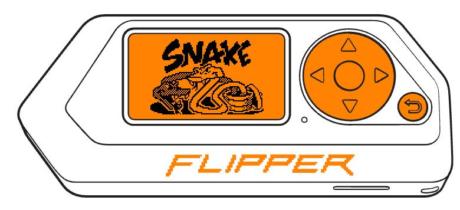
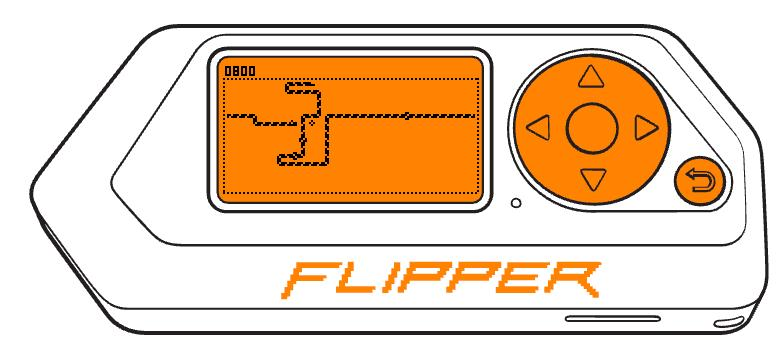
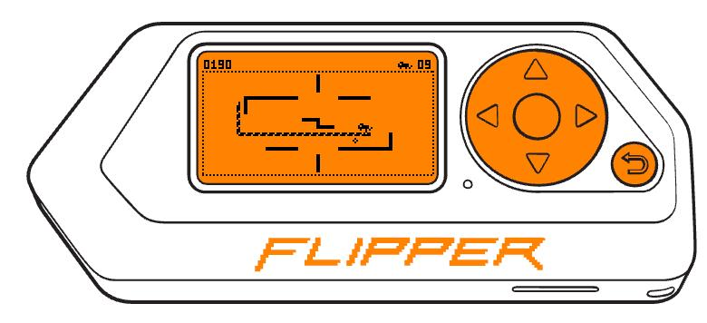

# 🐍 Snake 3310 per Flipper Zero

> *Ricordi quel serpentello che si allungava pixel dopo pixel sullo schermino verde del cellulare?*

<p align="center"></p>

Erano i primi anni 2000. Il telefono stava in tasca, la batteria durava una settimana e non c'erano notifiche da controllare. C'era solo lui: un serpente fatto di quadratini, un pallino da mangiare e la sfida di battere il record del fratello, del compagno di banco o del collega in pausa caffè.

Lo si giocava sull'autobus, in sala d'attesa, sotto il banco durante la lezione. Ci giocavano i ragazzini e ci giocavano i genitori, spesso passandosi lo stesso telefono. Bastavano quattro tasti e un pomeriggio qualsiasi diventava una gara.

**Snake 3310** nasce da quella nostalgia. È un omaggio al classico dei cellulari di quegli anni, ricreato da zero per un altro piccolo dispositivo da tasca: il **Flipper Zero**. Schermo monocromatico, pixel ben visibili, tasti fisici: sembrava fatto apposta per riportarlo in vita.

---

## 🎮 Come si gioca

Guidi il serpente con le frecce, mangi i pallini e cresci. Più cresci, più è facile finire contro la tua stessa coda. Tutto qui, ed è proprio questo il bello.

<p align="center"></p>

| Tasto | Cosa fa |
|---|---|
| ⬆️ ⬇️ ⬅️ ➡️ | cambiano direzione (nel menu: scegli e regola le opzioni) |
| OK | pausa / avvia |
| Back | pausa, poi torna al menu |

## 🗺️ Le modalità

- **Senza bordi**: esci da un lato e rientri da quello opposto. Il campo è infinito, il nemico sei tu.
- **Bordi**: una cornice tutt'intorno, sbatterci contro significa game over. La versione più classica.
- **Quadranti**: due muri a croce dividono il campo in quattro stanze. Si passa da una all'altra solo uscendo dallo schermo.
- **Labirinto**: muri sparsi a girandola in mezzo al campo, bordi passanti. Serve un po' di strategia.

<p align="center"></p>

## ✨ Le novità di questa versione

Rispetto al ricordo originale ci sono alcuni tocchi in più:

- **Prede bonus che si muovono**: ogni tanto compaiono un ragno, un topo o una ranocchia. Valgono **+50 punti** e non allungano il serpente. Però non stanno ferme: zampettano una casella alla volta e in alto un conto alla rovescia ti ricorda che stanno per scappare.
- **Il serpente "vero"**: corpo a righe diagonali che seguono il verso di marcia, la bocca che si apre davanti al cibo e la pancia che si gonfia dopo ogni boccone e scorre fino alla coda.
- **Velocità da 1 a 9**: dalla passeggiata rilassata alla corsa all'ultimo riflesso. Più vai veloce, più punti fai.
- **Un record per ogni modalità**, salvato sulla scheda SD. Così la sfida continua anche il giorno dopo.
- **Suoni e vibrazione**: un trillo quando mangi, una fanfara quando catturi una preda. Se sei in riunione, dal menu si spengono.
- Il campo di gioco sfrutta tutto lo schermo del Flipper, fino all'ultimo pixel utile.

## 📲 Installazione

Copia il file `.fap` sulla scheda SD del Flipper in `apps/Games/`, con qFlipper o con [lab.flipper.net](https://lab.flipper.net). Poi apri **Apps → Games → Snake 3310**.

### ⚠️ Se compare "App Too Old"

Niente panico, il gioco non è rotto. Ogni app per Flipper Zero viene compilata per una specifica versione del firmware, e **non è possibile creare un unico file compatibile con tutte**. Se il tuo Flipper ha un firmware più recente (o più vecchio) di quello usato per la compilazione, all'avvio vedrai `App Too Old` (oppure `App Too New`).

La soluzione è ricompilarlo per il tuo firmware. Se hai installato [ufbt](https://github.com/flipperdevices/flipperzero-ufbt), basta aprire il terminale nella cartella del gioco e lanciare:

```sh
ufbt update   # scarica gli strumenti per l'ultimo firmware ufficiale
ufbt          # compila il gioco
```

Poi copia sul Flipper il nuovo file `.fap` che trovi nella cartella `dist/`. Fatto!

---

*Snake 3310 è un progetto amatoriale, fatto per divertimento e per nostalgia. Non è affiliato né approvato da Nokia o da altri marchi citati.*

Buona partita, e occhio alla coda! 🐍
